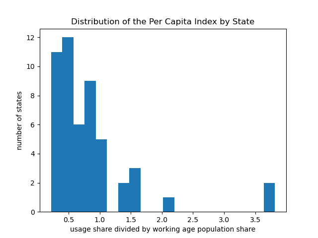
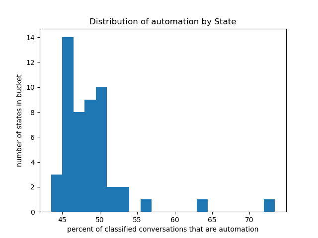
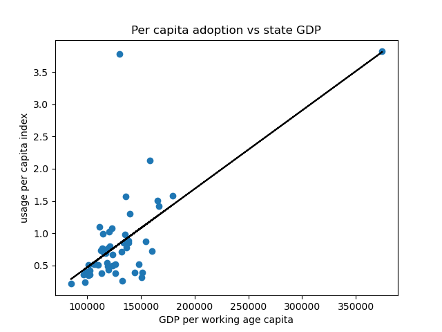
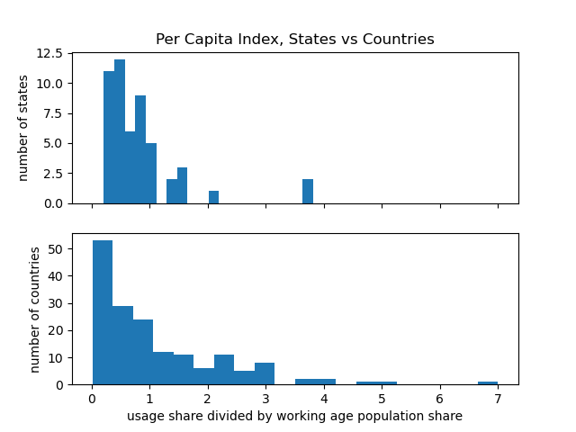

# Profile.md

All figures and numbers were calculated using the v3 enriched file, covering August 4-11 of 2025. Figures and numbers are calculated in exploratory_analysis.py

I am using research Q2: What explains geographic differences in AI adoption. We have two main factors here included within v3 that should provide some insight: per capita index and the automation share. Both are defined to the state level, and are added during enrichment meaning derived attributes that are not present in other versions, so initial exploration will decide if exploring these factors in other releases would be a good idea.

## Per Capita Adoption

This index is a state's share of US usage divided by the states share of the working age population. This is described as AUI and is an Anthropic metric. A baseline is 1.0 meaning a state would be using the amount of Claude we would expect, anything above means more than expected and vice versa. The distribution above is right skewed, with most states sitting below the 1.0 threshold and a few sitting far above 1.0. DC sits at 3.82 and Utah sits at 3.78 far above the rest of the states. 

| highest | index |
| --- | --- |
| DC | 3.82 |
| UT | 3.78 |
| CA | 2.13 |
| NY | 1.58 |
| VA | 1.57 |

| lowest | index |
| --- | --- |
| MS | 0.21 |
| WV | 0.23 |
| SD | 0.26 |
| AK | 0.31 |
| KY | 0.35 |

These values written above match those found in v3's report.

## Automation Share

This is the share of a state's classified collaboration that leans towards automation vs augmentation. The spread is much tighter than Adoption, many states are hovering around 50% with 2 distinct outliers:UT and SD .

| highest automation | share |
| --- | --- |
| UT | 73.4 |
| SD | 63.5 |
| ND | 56.0 |
| WY | 53.3 |

| highest augmentation | share |
| --- | --- |
| DC | 56.5 |
| VT | 56.4 |
| WA | 55.8 |
| NM | 55.0 |

Utah has the highest automation share 73.4%, with SD at 63.5%, this large percentage for Utah along with its abnormally high adoption rate makes it an interesting potential case study within the larger project. This is especially interesting when you consider DC which was the other large outlier in AUI has the highest augmentation share. V3's report flags Utah as possible automated traffic driven through that made it past their blockers so that is something to be aware of and it may be the reason its automation is so high, needs more substantiated evidence. 

| smallest samples | conversations |
| --- | --- |
| WY | 135 |
| AK | 139 |
| SD | 140 |
| ND | 183 | 

Above highlights that many of these state wide statistics need to be taken with a grain of salt since many states do not have a large sample to base off of, may highlight the need for a month long aggregation similar to the approach taken in release 6.

## Adoption against State GDP

GDP per working age capita is the only economic covariate already present in the initial download so provides some insight before joining the data externally. Across all states the correlation is 0.68 strong enough to show there is a relationship there.

As pointed out earlier we have 2 very strong AUI outliers in DC and Utah therefore the correlation without either state was considered. The correlation without DC is 0.42, and the correlation without Utah is 0.84 another indication that Utah is a very strong outlier.

## What is next based on the exploratory analysis 

Add in other economic/population data besides what currently resides such as occupation employment and wages, census industry mix etc. Research into Utah is this simply a coincidence based on one week of data is this a recurring thing across releases is there a reasonable explanation or is there something misleading happening. Handling sample sizes for small population and conversation states, a threshold of 100 conversation minimum is applied but breaking smaller states down to categories loses almost all information. Is 100 a reasonable minimum or should this be adjusted. 

## States or Countries

The same metrics exist at both state and country level.

| | states | countries |
| --- | --- | --- |
| geographies with usage | 51 | 172 |
| with a per capita index | 51 | 166 |
| with an automation share | 51 | 158 |
| median index | 0.70 | 0.73 |
| index range | 0.21 - 3.82 | 0.01 - 7.00 |
| median automation | 48.2 | 54.6 |
| automation middle half | 46.1 - 49.9 | 49.8 - 60.3 |
| median conversations | 1,811 | 583 |
| lower quartile conversations | 639 | 93 |
| index vs gdp | 0.68 | 0.75 |

| highest | index | conversations |
| --- | --- | --- |
| ISR | 7.00 | 10,941 |
| MCO | 4.93 | 25 |
| SGP | 4.57 | 5,375 |
| AUS | 4.10 | 18,753 |
| NZL | 4.05 | 3,647 |

| lowest | index | conversations |
| --- | --- | --- |
| TKM | 0.01 | 18 |
| NER | 0.02 | 71 |
| TCD | 0.02 | 67 |
| BDI | 0.03 | 59 |
| GIN | 0.04 | 77 |

Countries have a larger sample size and variation, roughly three times the observations with a much wider spread in adoption. The median country has 583 conversations against 1,811 for the median state and a quarter of countries sit under 93. Thin samples also break the automation measure, any mode under 15 conversations gets pooled into not_classified so a small country can be left with only its most common mode. The other tradeoff is outside data, the US has occupational and census data that is easy to join where countries would need World Bank equivalents. Going with countries for the larger sample and wider variation, the extremes look worth digging into as well. 

Numbers calculated in states_vs_countries.py, included small sample size countries on purpose since it is an important distinction from states and in favor of aggregating across releases. 

## Outside Data

Looking at World Bank Data and Github Data, a small exploratory analysis seeing what is available and how well it does in predicting adoption(correlations are spearman).

| variable | source | matched out of 172 | index | automation | conversations |
| --- | --- | --- | --- | --- | --- |
| developers_per_100k | github | 164 | 0.95 | -0.71 | 0.34 |
| gdp_per_capita | world bank | 165 | 0.87 | -0.65 | 0.18 |
| internet_pct | world bank | 164 | 0.74 | -0.65 | 0.27 |
| tertiary_enrollment | world bank | 142 | 0.74 | -0.76 | 0.46 |
| services_employment_pct | world bank | 153 | 0.74 | -0.59 | 0.20 |
| urban_pct | world bank | 165 | 0.58 | -0.47 | 0.25 |
| gini_index | world bank | 132 | -0.39 | 0.43 | -0.18 |
| population | world bank | 165 | -0.26 | -0.08 | 0.78 |

The developer correlation pops out at 0.95 ahead of GDP. Some of that is overlap between the 2 populations, but it does mean that developer work may represent a stronger connection that simply economic data.

A big takeaway is the automation column is all negative meaning everything that raises adoption also lowers automation which in turn should increase augmentation but could just increase unclassified, something to dig into further.

Population obviously correlates highly to conversations, but not to index and automation so population doesnt translate to how things are used.

Below are comparing countries developer base not population, only countries with more than 100 conversations are included here. A ratio above 1.0 is higher than would be expected and below 1 is lower than to be expected. This could mean more non-technical usage, something to explore further.

| most usage per developer | ratio | conversations |
| --- | --- | --- |
| ISR | 2.43 | 10,941 |
| KOR | 2.32 | 35,285 |
| MOZ | 2.18 | 453 |
| LAO | 2.15 | 381 |
| SEN | 1.99 | 828 |

| least | ratio | conversations |
| --- | --- | --- |
| UZB | 0.28 | 479 |
| BGD | 0.37 | 3,318 |
| MNG | 0.44 | 178 |
| KGZ | 0.51 | 276 |
| SGP | 0.54 | 5,375 |

Numbers from outside_sources_explore.py

## Non-Technical Usage

Claude is mostly spoken about as a technical tool but I wanted to focus on the split of technical vs non-technical. The split varies from 23% to 50% non-technical share depending on the country.

Occupations come from the SOC groups the release reports, classified off the task conversation rather than the user's job. Non technical means anything that is not computer, science or production work as defined by SOC groups.

Getting a comparable number was difficult, groups too small to report get pooled into not_classified, so small countries are often left with only computer work and read as 0% non technical. I kept the 28 countries that report at least ten groups, and since they do not all report the same ten, I compared them only on the eight that they all share. That drops the correlation with sample size from 0.80 to 0.35. Later releases aggregate by month instead of by week so I expect this to be much less of an issue.

| most non technical | share | automation | conversations |
| --- | --- | --- | --- |
| IDN | 50.3 | 54.7 | 18,030 |
| JPN | 49.9 | 43.3 | 35,298 |
| AUS | 49.6 | 46.0 | 18,753 |
| PER | 49.5 | 52.6 | 5,060 |
| ISR | 48.7 | 46.0 | 10,941 |
| KOR | 48.4 | 44.5 | 35,285 |
| USA | 48.1 | 49.1 | 208,200 |
| BRA | 48.1 | 63.9 | 35,482 |

| least non technical | share | automation | conversations |
| --- | --- | --- | --- |
| TUR | 23.0 | 54.1 | 10,402 |
| PAK | 28.0 | 64.1 | 9,264 |
| IND | 28.2 | 58.3 | 68,964 |
| VNM | 31.9 | 53.2 | 10,651 |
| UKR | 32.4 | 51.8 | 6,122 |
| MYS | 34.8 | 49.8 | 4,881 |
| ESP | 35.1 | 50.4 | 10,582 |
| POL | 35.7 | 46.2 | 9,972 |

Across the 28 countries here, 43.1% of usage is non technical work, though it ranges from 23% in Turkey to 50% in Indonesia.

Non-technical usage features many countries with strong economies that are strong regardless of sectors. Israel is worth pointing at, it has the highest per capita adoption of any country in the dataset and a high non technical share. 

| what goes with a higher non technical share | spearman |
| --- | --- |
| services_employment_pct | 0.30 |
| gdp_per_capita | 0.23 |
| developers_per_100k | 0.15 |
| tertiary_enrollment | 0.05 |

None of these predictors are really strong and that points to a gap in coverage, overall claude usage was predicted extremely well with simply the amount of developers per 100k people, non-technical usage is not as easy.

Numbers from non_technical_usage.py.

## Research Question + Whats Next

What share of a countries Claude usage is non-technical work, what predicts this share, and how does it change across releases.

The goal behind this reserch question is to focus specifically on the non-technical side of Claude's usage and how it is spread along with its adoption across releases. 

This produces an interesting question because technical usage is tied heavily to the developer share in a country as proven above however non technical usage does not have quite an obvious predictor. ILOSTAT produces employment by ISCO occupation for 148 countries that join will be next. 

Comparing across releases is vital to see not only how addoption is increasing or decreasing but to validate the research beyond a one week sample size.

Main limit currently is only 28 countries currently pass the thresholds to be included. I am optimistic in later releases where aggregation is done by month and not week this is less of an issue.

## Rebuilding Occupation Shares (v3-v5)

Numbers come from src/rebuild_occupation_shares.py

Only the v3 enriched file publishes the Occupation Shares(soc_pct). I rebuilt the logic used in v3 enriched, following Anthropic's v3 preprocessing notebook, to stretch across the 3 releases. Each O*NET task is matched to its SOC group through the task statements file.

The rebuilt v3 matches to Anthropic's v3 enriched numbers exactly(718 rows, max difference 0.0000). Each task also matched an O*NET task statement 0.0% non-matching rate across the 3 releases.

1 change I made for future analysis is each task can be assigned to multiple major groups. The way v3 enriched handles this is just allowing each conversation to be counted multiple times. I wanted each conversation to weigh the same so I divided the weight of the conversation evenly between its groups. The splitting shared tasks moved shares: 0.007 % points on average, and a maximum of 0.238 % points at most in v3.

| Release | Countries with 200+ conversations | Countries with at least one occupation group | Countries with 10+ occupation groups |
|---|---|---|---|
| v3 | 115 | 111 | 28 |
| v4 | 118 | 115 | 30 |
| v5 | 117 | 116 | 31 |

To compare across releases I use a basket strategy talked about previously. I use the 24 countries that clear the 10 group cut across all three releases, and use the 7 that each of them reports in every release: 2 technical (Computer and Mathematical; Life, Physical, and Social Science) and 5 non-technical( Arts, Design, Entertainment, Sports, and Media; Community and Social Service; Educational Instruction and Library; Office and Administrative Support; Sales and Related). Production has dropped out because it was missing for at least one of the passing countries in at least one release.

## Research Question 

What explains the differences in non-technical share of Claude usage across countries, and does that share shift across releases?

The focus has shifted to explaining the differences between countries much less obvious than overall adoption which was explained by number of developers. v6 publishes the occupation major groups directly and aggregates by month so it contains more than the 28 that pass the cut in v3-v5. v6 will be the test dataset and v3-v5 will be used to see changes over time. 

## Hypotheses

**Hypothesis 1: Non-Technical usage increases from v3 to v5**
- H0: Median difference in non-technical usage share is 0
- H1: Median difference in non-technical usage share is not zero(predicting an increase)
- Wilcoxon signed-rank test on the 24 paired countries, using alpha = 0.05

**Hypothesis 2: ICT employment share is correlated with non-technical share**
- H0:ρ = 0
- H1:ρ ≠ 0
- Spearman coefficient on v6(May 2026), alpha = 0.05
- predicting negative, but no v3 value to go off of

**Hypothesis 3: Services employment share is correlated with non-techincal share**
- H0:ρ = 0
- H1:ρ ≠ 0
- Spearman coefficient on v6(May 2026), alpha = 0.05
- predicting positive, ρ=0.30 in v3

## Limiting Factors

- v3-v5 only covers the 24 countries with the most usage, smaller usage countries are not covered in this portion of the analysis, v6 will have a larger corpus.
- The basket only uses 7 of the possible 22 groups.
- v6 may assign differently to v3, and may not use the method I hav chosen for splitting tasks with multiple groups, but only 0.007 points on average difference.

